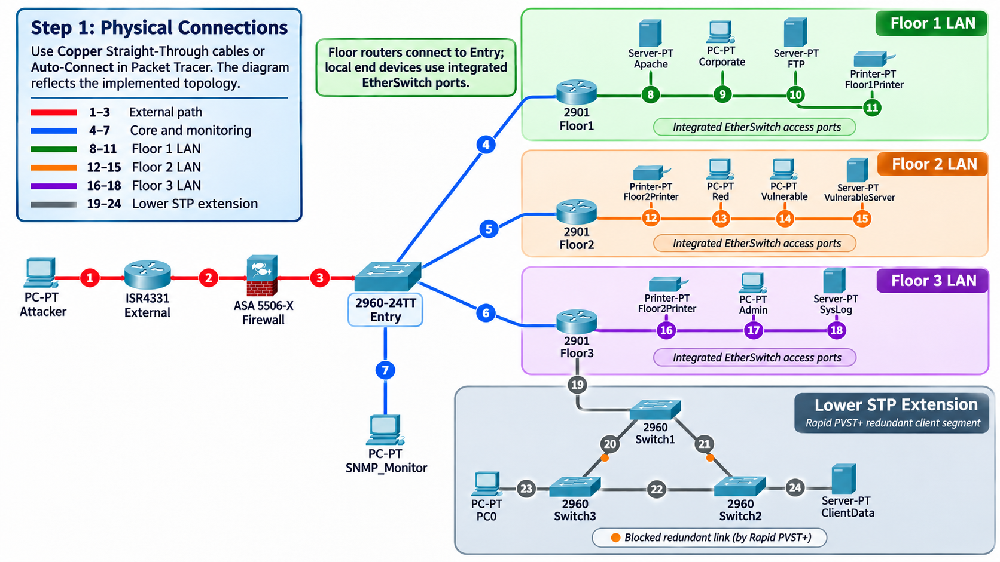

# AsterionNetworkTopology



## Descriere

**AsterionNetworkTopology** este un proiect de rețele de calculatoare implementat în **Cisco Packet Tracer**, care simulează o infrastructură enterprise pe trei etaje, având în vedere:

- **Routeri** Cisco 2901 (etaj și perimetru)
- **Firewall** Cisco ASA 5506-X
- **Switch-uri** Cisco 2960-24TT (incluzând redundanță STP)
- **Servere** pentru HTTP, FTP, Syslog și ClientData
- **Stații de lucru** și PC-uri pentru teste de securitate
- **Protocole** implementate: STP, SSH, SNMP, NAT

## Funcționalități principale

| Temă | Implementare | Documentație |
|------|-------------|--------------|
| **STP** | Rapid PVST+ pe Switch1–Switch3 | Secțiunea 7 din documentație |
| **SSH** | Administrare securizată a routerelor Floor1–3 | Secțiunea 8 din documentație |
| **SNMP** | Monitorizare centralizată prin SNMP-Monitor | Secțiunea 10 din documentație |
| **NAT** | Publicare portal HTTP prin ASA | Secțiunea 9 din documentație |
| **Syslog** | Colectare centralizată pe Floor3 | Secțiunea 11 din documentație |

## Topologii disponibile

- `NetworkTopology.png` - Topologia completă a infrastructurii
- `NetworkTopologyCisco.png` - Organizarea conexiunilor Cisco
- `NetworkTopologyMemaid.png` - Varianta memaid a topologiei

Fiecare imagine este plasabilă în documentele folosind sintaxa Markdown:
```markdown

```

## Adresare IPv4

| Subrețea | Gateway | Utilizare |
|----------|---------|-----------|
| `192.168.10.0/24` | `192.168.10.1` | Floor1 (Corporate) |
| `192.168.20.0/24` | `192.168.20.1` | Floor2 (Security Lab) |
| `192.168.30.0/24` | `192.168.30.1` | Floor3 (IT Administration) |
| `192.168.40.0/24` | `192.168.40.1` | ClientData (Redundant) |
| `10.0.1.0/24` | ASA `10.0.1.1` | Tranzit inter-etaj |

## Componente hardware

- **3 × Cisco 2901** - Routeri de etaj
- **Cisco ISR4331** - Router de perimetru
- **Cisco ASA 5506-X** - Firewall perimetru
- **Cisco 2960-24TT Entry** - Switch central
- **3 × Cisco 2960-24TT** - Switch-uri redundante ClientData
- **Module EtherSwitch** - Integrate în routere
- **PC-PT** - Stații de lucru ( Corporate, Red, Vulnerable, Admin, PC0)
- **Server-PT** - Servere (HTTP, FTP, VulnerableServer, Syslog, ClientData)
- **Printer-PT** - Imprente locale

## Securitate perimetrală

- **Firewall ASA** controalează accesul la/re din exterior
- **NAT static** pentru publicare HTTP (`192.168.10.10` → `10.0.0.5`)
- **ACL-uri** filtră traficul la interfața outside
- **SSH v2** pentru administrare securizată pe toate routeri

## Monitorizare

- **SNMP-Monitor** (10.0.1.20) interoghează toate echipamentele
- **Syslog** centralizează evenimentele de pe toate etajele
- **MIB Browser** pentru consultarea OID-urilor (uptime, nume dispozitiv)

## Despre Asterion Digital Services

Organizația Asterion Digital Services oferă servicii web, administrare infrastructură IT și evaluare securității sistemelor informatice. Activitatea este distribuită între departamente cu responsabilități distincte: operațiuni corporative, laborator de securitate și administrare tehnică.

Infraestructura de comunicații encompass o clădire de birouri cu trei etaje, fiecare având rețeaua locală propriu, comunicarea între ele fiind asigurată prin un segment central de interconectare. Un firewall perimetral controlează accesul către mediul extern, iar serviciile de administrare și monitorizare permit echipei IT să urmărească funcționarea echipamentelor.


*Proiect realizat pentru cursul de Rețele de Calculatoare - Universitatea*